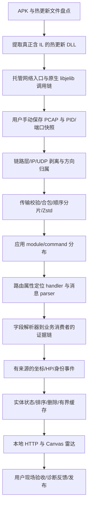

# 从零实现 UDP 雷达：从未知文件、未知流量到 v2.2

这篇是实现教程，按开发依赖展开。目标是让持有同版本输入的读者知道：先分析什么，怎样找到协议，怎样把字节证明为位置，怎样写出持续运行的网页雷达，以及每一步怎样判断做对了。运行和部署命令另见 [REPRODUCE.md](REPRODUCE.md)，不能拿部署成功代替协议研究完成。

这是固定项目的可重复方法，不是任意游戏一键解析器。原始 APK、热更新、玩家流量和 CSV 不公开，读者需自行取得有权分析的输入。文中的现场采集由读者手动执行；本次补教程没有启动游戏、抓包或服务。

## 0. 先看完整路线和交付物



| 阶段 | 必须拿到的结果 | 此时不能声称的结论 |
|---|---|---|
| 文件盘点 | 架构、版本、输入哈希、托管 DLL | 找到文件就等于完成 Dump |
| 网络定位 | 托管与原生收发调用链 | 枚举里有 UDP 就代表本局走 UDP |
| 流量归属 | 同期 PID、本地端口、PCAP、方向 | 某端口数据多就一定是游戏主流 |
| 传输恢复 | 完整应用消息及来源记录 | 固定跳 10 字节就覆盖所有包 |
| 字段研究 | field→成员→业务用法→数值转换 | 三个变化整数就是坐标 |
| 离线核对 | 原始值、缩放、包号、序号可追溯 | 数值合理就等于服务端/现场验证 |
| 雷达工程 | 增量状态、可视化、收尾、诊断 | 页面打开等于初始化/姓名已收到 |
| 发布 | 原运行字节、流程、工具、清单、边界 | 当前机器通过等于跨设备验收 |

源码分工：`src/protocol.py` 管字节到事件，`identity.py` 管身份消息，`server.py` 管增量状态与只读 HTTP，`runner.sh` 管 Android 采集生命周期，`app.js` 管显示。`dist/` 保留九个原机运行文件，不是另一个不同实现。

## 1. 建立自己的工作目录和工具环境

电脑可使用 Linux 或 WSL Ubuntu。文中命令从解压后的仓库根目录执行，下面的 input/work 表示本地私人工作区；不要把它上传 GitHub。Android 原生 shell 与 Operit Ubuntu 是两个不同环境，手机路径见第 13 章。

建议先准备 Python >=3.9、libzstd、git、unzip、binutils、.NET 8 SDK；UnityPy/Capstone 仅研究时需要。Ubuntu 的 Python、libzstd、unzip、readelf/c++filt 可以由发行版包提供，.NET SDK 按对应系统安装说明准备。

```bash
python3 --version
python3 tools/check_environment.py
dotnet --list-sdks
readelf --version
c++filt --version
python3 -m pip install -r requirements-research.txt
```

安装/restore 可能联网；具备依赖后，后面的分析只读本地输入。本项目打包环境没有 .NET SDK，三个 csproj 的标准构建尚待电脑端实际验证，提供命令不代表已经跑过。

本教程用相对路径表达私人材料：

```text
input/game.apk                 自行取得的固定版本安装包
input/update.bundle            自行取得的 UnityFS 热更新包
input/round.pcap                用户手动采集的真实经典 PCAP
input/sockets.txt               同期 PID/本地 UDP 端口快照
work/apk/                      APK 解包
work/hotupdate/                提取的 TextAsset/托管 DLL
work/index/、work/il/          类型索引/IL
work/native/                   原生函数反汇编
work/study/                    协议统计、选中应用消息、字段结构
```

这些只是路径约定，不是包内提供的输入。input/work/build/bin/obj/日志不得留在最终发布目录。检查器会拒绝它们，研究完成后将整个私人工作区保存在仓库外。

## 2. 从 APK 到有可读 IL 的热更新 DLL

### 2.1 先确认引擎、架构和程序集入口

```bash
unzip -l input/game.apk
unzip input/game.apk -d work/apk
```

观察 `lib/arm64-v8a/`、`assets/bin/Data/`、`ScriptingAssemblies.json`、metadata 位置和 Unity 版本标记；不能把文件名当作已恢复的程序集。

固定样本的 Unity 为 2022.3.62f3，主要原生分析用 AArch64 `libjelib.so`。同一 APK 还有 ARM32 文件，不能将 ARM32 文件偏移套到 AArch64。本项目最初也做过 metadata/IL2CPP 恢复，但网络主线后来直接读取热更新托管程序集：先解决有 IL 的那部分，不必等待整个 native Dump 完成。

本项目历史输入在解包目录 `assets/android/data/code/` 下，文件名以 `updatescript` 开头，可先查看这里：

```bash
find work/apk/assets/android/data/code -maxdepth 1 -type f -iname 'updatescript*'
```

对候选核对bundle哈希，选择匹配项并将路径填入下一步的--bundle；input/update.bundle只是教程占位，不是要求必须重命名。其他版本的热更新不一定在base APK里，找不到时检查自己保存的更新资源/资源缓存，路径会随版本变化。找不到对应bundle就无法完成该输入步骤，不能拿DummyDll冒充真正的IL。

### 2.2 从 UnityFS TextAsset 提取程序集

```bash
python3 research/extract_hotupdate.py --bundle input/update.bundle --output work/hotupdate
```

工具遍历 TextAsset，读取 m_Script，遇到 MZ 头可标为 PE 候选，写 asset-manifest.json。MZ 只说明 PE 候选；再由 Mono.Cecil 成功读取并看到方法体，才能证明是可分析的托管程序集。

固定输入识别：

| 输入 | SHA256 |
|---|---|
| UpdateScript_500.dll | 1ce1e36603c3c481a03a321edc1d08f6ba24f165855021b808effbb90d84a5ec |
| libjelib.so | a6e64e050d3ac896bb5310e3bcfc80f8d724188b6db1955e216bb868641526f6 |
| 热更新 bundle | 63a76b500939a3b3e99233975abee294e31586cd6c33aaabd090193d3239eb11 |

每次先记录哈希。只有恢复脚本强制固定哈希门禁；普通提取/反汇编工具会记录哈希但不自动判定同版本，使用者必须核对。

### 2.3 可选支线：metadata/IL2CPP 恢复到底解决什么

它用于补齐静态类型与原生地址分析，不是 UDP 雷达必需的第一道门。

```bash
python3 research/restore_inputs.py metadata --input work/apk/assets/bin/Data/Managed/Metadata/global-metadata.dat --output work/metadata-restored
python3 research/restore_inputs.py il2cpp --input work/apk/lib/arm64-v8a/libil2cpp.so --metadata-report work/metadata-restored/restore-report.json --output work/il2cpp-restored
```

metadata 恢复源码展示固定文件的稀疏 XOR 区间、0x66 与表边界/stride/token 检查。IL2CPP 分支针对固定 .rodata 的 XOR/块重排，依赖 metadata 报告的 images 校验；初始 AES 窗口和代码区没有全恢复。输出是分析副本，不能替换安装库。

历史静态 Dump 有 dump.cs、方法地址索引和 DummyDll，但 header/stringliteral 等附属导出不完整。完整 native Dump 链不能被写成全验收；主线用实际热更新 DLL 的 IL 和 libjelib 的符号/汇编，避免把缺失导出当作已经齐全。

## 3. 从混淆程序集定位网络入口

### 3.1 建索引，不从所有混淆类盲猜

```bash
dotnet build research/managed/StaticAssemblyInspect -c Release
dotnet build research/managed/ProtocolEvidenceInspect -c Release
dotnet build research/managed/StaticReferenceInspect -c Release
dotnet run --project research/managed/StaticAssemblyInspect -c Release -- index work/hotupdate/UpdateScript_500.dll work/index
```

得到 candidate-index.json、type-index.tsv、network-crypto-calls.json。索引按 udp/socket/send/receive/crypto 等词和外部 API 调用收敛候选；混淆名称不能靠关键词覆盖全部方法，下一步要追调用与字段引用。

可以用 rg 搜索，系统没有 rg 时改 grep：

```bash
grep -Ein 'udp|socket|libUdp|ExternDll|DHPODGOMOID|NLJGAHGAAEH' work/index/type-index.tsv work/index/candidate-index.json
```

固定样本路径：DHPODGOMOID 选择传输模式；NLJGAHGAAEH 通过 ExternDllManager 调 libUdpConnect/libUdpSend/libUdpRecv；原生实现位于 libjelib。其他 TCP/KCP 枚举也存在，不能由“存在”判断当前会话使用它。

```bash
dotnet run --project research/managed/StaticAssemblyInspect -c Release -- types work/hotupdate/UpdateScript_500.dll work/net-types DHPODGOMOID NLJGAHGAAEH ExternDllManager
dotnet run --project research/managed/StaticAssemblyInspect -c Release -- il work/hotupdate/UpdateScript_500.dll work/net-il 0x06012A84 0x0601F599
```

看 modes 分支实例化哪个对象，P/Invoke entrypoint 是什么，接收后在哪里读取应用头和查 handler。types 导出中的方法 token 再交 il；需要找某个 token 的调用者则用 StaticReferenceInspect：

```bash
dotnet run --project research/managed/StaticReferenceInspect -c Release -- work/hotupdate/UpdateScript_500.dll work/recv-callers 0x0601F599
```

检查 references.json 的 hits 与对应 IL，不只看候选数。构造函数、序列化写入器、解析器、消费逻辑必须分清：同一消息类中很多函数很像，函数签名和实际读写指令决定它的角色。

## 4. 用户手动取得 PCAP，同时保留 PID/端口证据

这一步会生成私人流量，需要在自己的设备/账号、明确准备好时由用户手动做。教程提供命令，不由助手代执行。本次补文档只使用既有已停止输入。

### 4.1 Android 原生 Root shell 做端口归属

```sh
pidof com.pi.czrxdfirst
ss -H -u -a -n -p -e
```

保存同时刻 PID 与 socket 表。`ss` 的本地端口和 PID 关联才是归属依据；远端端口、相似 IP、数据量或包里出现姓名均不是。端口会变，快照要覆盖进入场景前后，不能只取一次然后整场硬编码。

### 4.2 在用户选择的短会话中手动采集

原生 shell 中将 PCAP、输出和 TMPDIR 都放在私人会话目录。例如本项目根下 `日志/manual-session/`：

```sh
SESSION='/storage/emulated/0/Download/超自然行动/日志/manual-session'
mkdir -p "$SESSION/tmp"
export TMPDIR="$SESSION/tmp"
pidof com.pi.czrxdfirst > "$SESSION/game-pids.txt"
ss -H -u -a -n -p -e > "$SESSION/sockets-before.txt"
/system/bin/tcpdump -p -i any -nn -s 0 -U -B 4096 -w "$SESSION/round.pcap" udp
```

tcpdump 前台运行；用户主动进入/操作自己的测试场景，结束时 Ctrl-C，确认进程已结束再离线读取。这里会记录全机 UDP，存在其他应用隐私，原包不能公开。后续 `ss` 端口表也应手动保存；若要连续跟踪，成品 runner 已实现轮询，不需要另外写会干扰网络的发包器。

将 PCAP 和端口材料用 USB/MTP 复制到自己的 input 目录。默认仅使用已由 PID 确认的本地端口。如果无法确定归属，先补快照，不直接拿全设备流量当游戏包。

### 4.3 为什么原始数据要从进场前开始

后续坐标会持续下发，但名单/本地 UID 可能仅在初始化出现。半路开始采集可能有点、没有名字；这不是必然的解析器 bug。反过来，收到名单但零坐标可能是主业务端口没识别到。保留 PCAP 允许把这两种情况分开。

## 5. 实现第一层：PCAP→链路帧→IP→UDP

不要一上来找 float；先让每条记录边界、时间戳和方向正确。

经典 PCAP 包含 24 字节全局头；每条记录是 16 字节记录头加 caplen 字节帧。用 magic 判大/小端与微/纳秒时间单位，检查 caplen <= original 和长度上限。实时尾读遇到半条记录要回退等待，不当完整包解析。

Android `-i any` 常出现 Linux cooked link 类型：113 的头长为 16，276 为 20。还可能有 Ethernet(1)、RAW(101)、IPv4(228)、IPv6(229)。不能拿固定“以太网14+IP20+UDP8”套所有 PCAP。源码 `PcapTail.poll` 和 `udp` 是相应实现。

IPv4 用 IHL 算头长、total length 限边界、protocol=17 才进入 UDP；本实现不重组 IP 分片。IPv6 当前只覆盖直接 UDP，不完整遍历扩展头。UDP 用大端 UInt16 读 sport/dport/length，取载荷时再检查长度。

方向规则：已确认本地端口出现在 dport 且 sport 不在本地集合，视为候选入站；sport 在本地集合则为出站。cooked packet_type=4 表示出站提示。双方端口均命中时有歧义，不靠猜测归属。这里的规则有具体边界，不等于完整网络栈。

第一层验收：记录总数和时间区间与 PCAP 工具一致，能按方向统计已知端口；结构损坏、分片、非 UDP 必须各自记账。研究输出可以包含端点，在公开记录中只留统计，不公布服务器地址。

## 6. 从原生收发器推导传输外壳

### 6.1 先看真实代码，区分压缩、握手和加密

```bash
python3 research/disassemble_native.py --so work/apk/lib/arm64-v8a/libjelib.so --output work/native
```

脚本读取 ELF64 little-endian AArch64 PT_LOAD，用 VA 映射文件偏移，readelf 取 dynsym、c++filt 解名、Capstone 反汇编。不要将符号 VA 直接当文件偏移。按 manifest 找 JeUdpClient::RecvLoop、udpParse、msgParse、AsyncSend、GetMsg、JeMsgQueue::PushMsg。

沿接收链看 recvfrom 后哪些字节被读、何时分支重组/解压、何时放队列；沿发送链回看头字段如何写。send/recv 双向证据比“试着跳过几个字节正好能解析”更可靠。

`Zstd::Decompress` 的 PLT 调用和 flag 分支说明压缩，不是 AES 解密。cookie 的不透明数据、变化的序号/时钟不自动叫会话密钥。局部链未见解密也不能证明整个游戏其他模式都不加密。

### 6.2 固定样本下行确认的头

| 相对该传输片的字节 | 用法 | 证据和实现 |
|---|---|---|
| 0 | 校验字节 | AsyncSend 固定 VA 0x5ab78..0x5abbc |
| 1 | flag/kind | 低4位数据 kind 4/5；其余分支见下文 |
| 2..3 | 小端 UInt16 序号 | 连续片/合包链校验需考虑回绕 |
| 其后头区 | 未全部解释的公共部分 | 不能给未知字节编造业务含义 |
| 普通/首片应用起点 | 10 | 公共头8字节后还有2字节 |
| 后续片有效载荷起点 | 8 | 先去后续片头再拼接 |

校验：

```python
valid = data[0] == ((len(data) + data[1] + data[2] + data[3]) & 0xff)
seq = int.from_bytes(data[2:4], 'little')
```

公式里的 `len(data)` 是该片的完整字节数，不是整个 PCAP 记录长度。不能将 seq 作为一个整数加进去；序号高字节非零时两种公式会不同。曾经的测试正是在这个边界失败，后来回到 AsyncSend 汇编确认分别相加。

kind/flag 按实际条件判断。0x20 表示后续分片，0x40 表示还有后续，0x80 是压缩；当前 feed_many 跳过非数据 kind，以及 kind4 带控制位的分支。不要简化成“所有带某位的包全丢”。

### 6.3 上下行外壳不能对称照搬

上述首片10/后续8和序号2规则属于当前成品解析的**下行**。早期真实样本的上行应用起点为14、序号在6..7；历史离线分析脚本与实际3/851消息分布共同印证。新增survey工具已分别处理，上行有分片标志时明确跳过并记账，不能擅自套下行拼接。

外层校验仍检查byte0与length+byte1..3的关系，不因为上行业务序号在6就改变校验公式。若上下行头差异没识别，会出现“能读UInt16但module突然全是怪值”，这不是立即证明加密，而是要先回查边界。

### 6.4 一条 UDP 记录可能不是一条应用消息

`transport_segments` 先检查整条是否满足单片校验；不满足时，对候选切点做完整头、校验和连续序号链约束。长度校验只给长度模256，候选长度要加256继续尝试；只有全载荷唯一完整解才拆。实现有搜索预算/段数上限，避免对脏数据无界递归。

不能扫 UTF-8 字符串找姓名，再倒推切点；这会把业务语义混进传输层，难以发现漏包或错配。

### 6.5 先重组完整下行传输消息，再 Zstd 解压

每个流的键包含源/目的地址端口及 kind。首片保留初始 flag 与 body[10:]；后续片只追加 body[8:]，序号必须等于 next。末片到达再产出完整 app，若初始 flag 有压缩位则解压。每消息8 MiB、512片、15秒和16条流等上限见代码；缺片/乱序/过期直接记账，不伪造恢复。

只有此后，偏移0才是应用头。**IP 分片、游戏传输分片、同记录合包是三种问题，不能用同一种“拼接”混在一起。**

## 7. 用真实流量决定分析哪种应用消息

应用头是两个大端 UInt16：

```python
module, command = struct.unpack_from('!HH', app)
body = app[4:]
```

新增研究入口可从自己的 PCAP 统计两方向，尚不假设业务 schema：

```bash
python3 research/pcap_lab.py survey input/round.pcap --ports 45283 --direction both --summary work/study/survey.json
```

45283只是历史主业务端口示例，必须替换为自己的已确认业务流；其他辅助端口即使属于同一游戏，也可能采用不同外壳，需另行统计/验证。工具复用固定版本传输实现，不是未知协议自动推断器；前一章解释了怎样从原生代码得到这些规则。这里只把已确定的规则用于发现当前 PCAP 实际出现的 module/command。

看 commands 列表：direction、module、command、applications；不要把包数、传输片数、应用数、实体动作数混为一谈。返回3表示部分处理/无匹配，可查看 decode_errors、分片计数、pending，不能只看成功退出码。

### 本项目的重要转折：3/50 不是这次对局的主线

初期从静态网络入口找到 3/50 BatchMove，并追到 MNEHOHLMOCB→PMEEGHODBLL→DHFLOFIEDAF。位置向量标签虽为 wire5，实际却用 varint→ZigZag→除100。这是一条有静态证据的独立结构。

真实首份会话主要见到下行3/852与上行3/851。不能把 3/852 body 当 3/50 批量结构，更不能照搬它的 ZigZag/100；于是转到852 handler、场景实体和动作数组。

初期解码器现保留为 `research/legacy_move50.py`，输入是已经恢复的应用消息或显式 body，不是原始 PCAP：

```bash
python3 research/legacy_move50.py --workspace . --kind app --input work/study/move50.app --output work/study/move50-decoded.json
```

只有确实取得3/50应用消息时才能执行；没有此消息就保留静态证据，不能造样本宣称实测。原历史脚本未证明该分支在那次会话出现，教程不把它升级成现场验收。

## 8. 由路由属性找到 3/852 的消息结构

先扫描方法自定义 attribute，而不是搜十进制852就认定 parser：

```bash
dotnet run --project research/managed/ProtocolEvidenceInspect -c Release -- routes work/hotupdate/UpdateScript_500.dll work/routes.json 1 3 6 50 851 852 2005
```

固定路由属性 HNMOBHFEEON 的参数顺序是 command、module；用已知852 handler和其他路由交叉确认，不能写反。3/852 handler 为 FMPDBDEEKGC::MMMFDMBPCAO，token 0x06016A77，参数类型 BILKNBOMFCO。

```bash
dotnet run --project research/managed/StaticAssemblyInspect -c Release -- types work/hotupdate/UpdateScript_500.dll work/scene-types BILKNBOMFCO EMEOJKBBAAA FOOBJALACEJ
dotnet run --project research/managed/StaticAssemblyInspect -c Release -- il work/hotupdate/UpdateScript_500.dll work/scene-il 0x06016A77 0x06026483 0x06004FBC 0x06012856
```

看 handler 怎样遍历场景实体、parser怎样读取 tag并写字段，不能拿 writer或构造函数当 parser。每次记录字段号、wire、读值类型、目标成员、重复/packed处理，得到下表。

| 层级 | field | 读取/对应输出 |
|---|---|---|
| 场景 BILKNBOMFCO | 4、5 | varint，帧相关值，保留 frame4/frame5 |
| 场景 | 6 | 重复嵌套 EMEOJKBBAAA 实体 |
| 场景 | 7 | 删除编号，接受 unpacked或packed |
| 实体 EMEOJKBBAAA | 1 | 运行时 id1 |
| 实体 | 2 | 次编号 id2，保留，不能当账号UID |
| 实体 | 3 | 类别 |
| 实体 | 4 | 重复嵌套 FOOBJALACEJ 动作 |
| 动作 FOOBJALACEJ | 1 | 动作 kind |
| 动作 | 2 | scale |
| 动作 | 3 | Int64 值列表，packed/unpacked |
| 动作 | 4 | 载荷保留字段，本雷达不使用其业务语义 |

### 8.1 从真实应用消息逐层检查，而不是只看最终 JSON

```bash
python3 research/pcap_lab.py extract input/round.pcap --ports 45283 --direction in --message 3/852 --output work/study/scene.app
python3 research/pcap_lab.py fields work/study/scene.app --output work/study/scene-fields.json
python3 research/pcap_lab.py fields work/study/scene.app --path 6:1 --output work/study/entity-fields.json
python3 research/pcap_lab.py fields work/study/scene.app --path 6:1/4:1 --output work/study/action-fields.json
```

fields 默认从绝对偏移4开始；path中的 `6:1/4:1` 表示第1个field6子消息里的第1个field4，发生次数从1开始。若样本第一个场景没有实体/动作，工具会拒绝；按输出选择有数据的 occurrence，或 extract 增加 `--occurrence N`。不能为了命令通过假设每帧必有field6。

fields 只列绝对偏移/长度/无符号varint与短hex，不猜嵌套语义，不自动把任意块递归成消息。wire1/5需显式验证后加--standard-fixed；对前述3/50自定义wire5不能这样用。

这一步验证字节边界与 parser 对应，尚未证明 kind1真的是位置；下一章追业务消费。

## 9. 从“整数列表”证明坐标，而不是按变化猜

### 9.1 先追动作消费者和向量构造

枚举里 Position=1只是线索，还需动作分派→取三值→缩放→Vector3→业务位置调用的链。固定证据中0x06002E55调用向量辅助0x06021E2E；0x06021E29也是同类写Vector3链。

```bash
dotnet run --project research/managed/StaticAssemblyInspect -c Release -- il work/hotupdate/UpdateScript_500.dll work/position-il 0x06002E55 0x06021E2E 0x06021E29
dotnet run --project research/managed/StaticReferenceInspect -c Release -- work/hotupdate/UpdateScript_500.dll work/position-callers 0x06021E2E
```

要看到三个数组分量按顺序读取、转浮点、除以传入scale以及调用方传入哪个动作的scale。再从引用定位位置设置，而不是仅用“函数名像向量”下结论。详细token索引见 [EVIDENCE_WALKTHROUGH.md](EVIDENCE_WALKTHROUGH.md)。

### 9.2 两种坐标编码不要混用

| 分支 | 实际整数方式 | 坐标计算 | 验证状态 |
|---|---|---|---|
| 3/50中DHFLOFIEDAF向量 | 自定义wire5 varint、ZigZag | signed/100 | 早期静态链；该真实主会话未观测 |
| 3/852动作1 | Int64补码varint，packed/unpacked | raw/action.scale；样本常见1000 | 主会话真实解码与CSV核对 |

3/852的负数转换：

```python
signed = unsigned - (1 << 64) if unsigned >= (1 << 63) else unsigned
xyz = [raw / scale if scale > 0 else float(raw) for raw in values]
```

当前实现只将 kind1且恰好三值产出位置。scale<=0时保留raw浮点，不静默除零；不知道语义时不能宣称已换算米。非位置动作不套这个转换规则。

### 9.3 离线验证要留下原值和来源

记录 packet、timestamp、local_port、stream、sequence、frame4/5、category、id1/id2、raw_x/y/z、scale、x/y/z。这样才可从图上点回到原包定位错误。

```bash
python3 tools/replay_pcap.py input/round.pcap --ports 45063,45283 --summary work/study/replay-summary.json --events work/study/events.jsonl
```

有独立基线CSV时再加--expected-csv。历史基线8184包、7101位置逐条CSV匹配，这是字节/转换与回读一致性；CSV若由同一算法产生，不构成独立现场真值。用户亲自观察移动、停止、不同高度和切换场景才能补现场证据。本项目后续原机反馈可用，但不因此承诺所有版本。

上行3/851的完整结构没有独立确认，不把它当作已验收自身坐标，不为实现“自己”而猜上行字段。

## 10. 姓名、UID、本地身份与HP怎样加入

### 10.1 姓名从UI反查数据，再回到网络parser

可读类 CzrPlayerNameUI::SetInitData 参数含字符串、UInt64和UInt32，是入口线索。追谁传入这些值，再追角色构造、getter/backing字段到MNKGAOHNBGO；最后回parser确认字段，不扫描PCAP里的中文拼名单。

```bash
dotnet run --project research/managed/StaticAssemblyInspect -c Release -- il work/hotupdate/UpdateScript_500.dll work/name-il 0x0600EE78 0x060038F2 0x06003CEB 0x0602392C 0x0601CD83
dotnet run --project research/managed/StaticReferenceInspect -c Release -- work/hotupdate/UpdateScript_500.dll work/name-callers 0x0600EE78
dotnet run --project research/managed/StaticAssemblyInspect -c Release -- il work/hotupdate/UpdateScript_500.dll work/identity-link-il 0x0600654A 0x0600651A
```

MNKGAOHNBGO parser 0x0601CD83：field1 UInt32运行时实体号，field2 UInt64 UID，field3 UTF-8姓名。两个字典消费者将类别4实体的id1与这个运行时号相连，证明不是id2、预制体或位置接近关系。

### 10.2 初始化、名单增删与“自己”

| 消息 | 固定已解析内容 | 状态动作 |
|---|---|---|
| 3/1 登录/初始化 | field2本地UID、field3本地实体号、field5名单容器 | 清旧流身份/实体并建立本地状态 |
| 3/3 名单 | field1玩家列表 | 更新名单 |
| 3/6 名单增删 | field1玩家列表、field2删除ID packed/unpacked | 增量更新并删对应实体/HP |
| 3/2005 当前观察目标 | field1本地观察UID | 保留观察身份语义，不等同原登录账号 |

导出0x060110F7、0x0601B524、0x0601BF43及路由handler IL进行复核。`identity.py`是这些边界的代码实现；UID输出字符串，避免浏览器Number损失UInt64精度。

后端只对category4按流和id1关联。优先比较明确非零UID与本地UID，有本地实体号时可对应其命名空间；缺资料则保持未识别。手动选择参考点只改变画面中心，不改变协议身份。

### 10.3 HP要追动作31的真实写入

```bash
dotnet run --project research/managed/StaticAssemblyInspect -c Release -- il work/hotupdate/UpdateScript_500.dll work/hp-il 0x060038F8 0x06003ACA 0x06002DAA
```

玩家分派将动作31送入0x06003ACA，values[0]经conv.i4写生命字段；NPC链也使用第一值。实现转Int32后显示原值：

```python
hp = ((values[0] + (1 << 31)) % (1 << 32)) - (1 << 31)
```

不除位置scale，不把额外值命名为最大血量或百分比。HP不一定和位置同时到达，所以后端维护独立HP缓存和时间戳，位置事件才显示的实体可附上此前收到的HP；HP缺失显示“未收到”。

## 11. 实现协议解析器的明确接口

先把字节层写成不访问进程、不依赖HTTP的纯解析层，再接在线采集。最小依赖顺序：

1. 有边界的Reader：varint、length-delimited、wire检查、字段数上限。
2. scene/entity/action结构，分清packed与unpacked，保留原整数。
3. identity结构，严格UTF-8，不按文本猜名字。
4. PCAP/IP/UDP、传输拆包/重组/解压。
5. feed_many：一条记录返回零到多条应用事件，错误分别计数。

示意接口（键来自实际实现，省略值不当作样本数据）：

```python
for timestamp, packet, link, frame in reader.poll():
    for event in decoder.feed_many(timestamp, packet, link, frame):
        state.apply(event)
```

scene事件带positions、health_updates、removed和帧号；identity事件带players、removed、reset和可选local_uid/local_entity_id。必须两个后端入口都消费feed_many：实时读与延迟端口补解析。旧feed只返回第一结果，是兼容入口；继续用它会再次漏合包尾部。

未知字段或坏长度不能悄悄跳过并计成功；本固定schema使用明确错误计数。不要为降低decode_errors把校验/长度检查删掉。

## 12. 从事件流建立不会串号的实体状态

网页需要“最新快照”，不是把每条位置无限加到列表。`server.py` 的结构可按下列顺序实现。

### 12.1 定义键与生命周期

流键`local_port@peer`隔离不同服务器/端口。实体键再加category/id1/id2。运行时ID可跨会话复用，不能全局按id1一个字典永久记。

每次apply先判断stream/kind/event_type的序号。16位回绕用`(new-old)&65535`，大于32767视作旧方向；identity和scene用独立顺序键，不能让高序号场景帧吞掉可靠名单通知。

游戏PID代际改变时清实体、身份、HP、顺序、去重和传输分片；用进程开始时间过滤缓存里的旧记录。仅PID相同并不保证游戏场景永不重置，3/1 reset也要处理。

### 12.2 更新与删除

位置到达更新最新xyz，轨迹只在位置变化时追加，deque最多60点。HP到达独立缓存，再合并已有实体。身份到达按流更新名单，并重新给存量category4实体附名；这样“先位置后姓名”也能补齐。

3/852 field7删除实体及HP；3/6删除玩家名单及对应类别4实体。后端300秒过期、最多512实体/HP、2048名单，网页更早变灰/隐藏，不让一场里所有旧实体占满画面。

### 12.3 增量读与有界日志

每约0.12秒尾读PCAP，未写完记录等下一轮，不从文件头反复全量扫描。线程更新快照加锁；HTTP读稳定副本，避免绘图读到一半更新的数据。

位置日志约16 MiB后停止追加，元数据约8 MiB；诊断约2秒原子写临时文件再rename。磁盘上限是工程防护，不表示被截去的数据仍保留。运行日志含隐私，不公开。

## 13. Android持续采集：为什么要先抓后识别端口

旧版发现端口才启动tcpdump，PID/端口变化又停启，出现约数秒记录空窗；那些未落盘字节无法靠后端补回，尤其可能漏进场名单。

v2.1改为用户手动启动一次runner时先起持续tcpdump，再起proot后端，`ss`每秒更新归属集合；端口变化不重启tcpdump。全机UDP先进入有限缓存，只有端口被PID确认后才补解析对应历史记录。缓存上限15秒/8MiB/8192条，超出就丢并记账。

实现次序：

1. 启动脚本验证时间/HTTP端口与项目路径，创建会话tmp和日志。
2. runner先记录一个持续PCAP，保留捕获进程PID与退出原因。
3. proot映射共享存储，Ubuntu Python运行server.py，只绑回环HTTP。
4. 等server-ready；失败或tcpdump退出就进入收尾，不能页面还在就假装采集中。
5. 循环维护PID/端口/时间与目录体积；默认600秒或约64MiB触发停止。
6. 停止脚本只终止有会话归属证据的PID，避免误杀其他tcpdump/proot；关闭网页不等于停止。

这是对初始化漏收的工程修复，代价是PCAP可能有其他应用UDP。为隐私必须严格限制会话并不公开原始文件。真实部署见REPRODUCE的手机Ubuntu/原生Root分层步骤；电脑--stage只是暂存，不会传手机。

## 14. 从快照画出能核对的网页雷达

### 14.1 本地HTTP与展示数据

server.py只监听127.0.0.1，提供`/api/state`及固定静态文件，不开放任意路径。Host限制为本机端口，设置no-store、nosniff、CSP，减少缓存和外部嵌入。前端使用textContent显示协议姓名，不将未信任文本拼进innerHTML。

快照保留时间戳、身份是否已收到、HP时间、端口和错误等。不能只展示点，把缺姓名/HP的原因藏掉。

### 14.2 世界坐标到Canvas

默认X/Z平面；选参考实体或自己作为中心C，span为可视世界宽度，画布宽W：

```text
pixels_per_unit = W / span
screen_x = W/2 + (world_x - center_x) * pixels_per_unit
screen_y = H/2 + sign * (world_z - center_z) * pixels_per_unit
```

sign默认-1，翻转选项改变上下方向。自适应范围与手动平移/缩放只是观察工具；没有地图配准和朝向证据，不能称为与游戏小地图完全对齐。

轨迹按同一投影绘制，按实体键着色不是敌我；本地身份明确才使用“自己”样式。3秒无更新变灰，30秒隐藏。表格同时列xyz、相对高度、水平距离和数据年龄，便于定位轴/缩放/停更问题。

### 14.3 拉取、暂停和跟随

前端约400ms轮询，2.5秒超时，失败显示后端未连接。暂停只冻结画面时钟，不停止采集，必须文字说明。自动跟随只使用最近明确is_local的实体；手动选参考取消自动self，不篡改身份数据。

## 15. 从真实bug反推跨层诊断

### 15.1 部分姓名显示、部分不显示

先区分名单未收到与收到但decode失败。历史样本定位到第115条PCAP记录：一条156字节UDP载荷里有序号15/16的两个3/6名单。旧版整个body当一条Protobuf，尾部传输头被当字段，出现zero identity field，名字整条丢掉。

正确修法是回到AsyncSend确定头校验、按唯一连续链拆包，再让feed_many的全部结果进入后端。不能在UI上填占位名或扫描载荷中的中文补洞。第97/98条记录还构成完整顺序传输分片，补齐后新样本坐标也从4363增至4429。

最终该真实样本：身份消息4、名单4、HP动作7、应用错误0；另4个IP分片未支持。用户随后原机反馈显示满意，但它不代表每局都不漏姓名。

### 15.2 诊断决策表

| 现象 | 先查 | 下一步证据 |
|---|---|---|
| 无端口 | capture.json、ss/PID | 系统权限、快照时刻、正确本地端口 |
| 有端口无应用 | 校验/压缩/方向/非UDP计数 | native收发链、真实头部、link类型 |
| 有3/852但无位置 | action_counts、scale/raw | 枚举只是线索，回到parser和位置消费者 |
| 有坐标无姓名 | identity_messages、roster_players、decode_errors | 进场前采集是否覆盖、合包/分片、身份路由 |
| 有名单但名字没附点 | category、id1、stream、重置/顺序 | 两个字典消费者的同命名空间证据 |
| HP永远缺失 | hp_actions是否有31 | 没收到与解析错误分开，不能凭UI猜最大值 |
| 数据突然回旧 | 序号、PID epoch、参考点年龄 | 乱序/重置/旧缓存过滤 |
| 退出码0但信息少 | 包数、目标事件、未处理指标 | “没报错”不是“收到全部” |

## 16. 最后怎样验收和开源

分开记录四件事：静态语义、真实PCAP回放、后端/文件工程检查、用户现场表现。每条结论注明输入哈希、版本与验证层级，避免一种证据冒充另一种。

可复现公开包应保留：本文、命令指南、证据检索索引、可读源码、原机成品、辅助工具、输入识别哈希与限制。不能公开：PCAP、玩家字段/端点、坐标明细、游戏DLL/SO/APK、密钥或设备私人路径。

```bash
python3 tools/build_dist.py --check
python3 tools/publish_check.py .
```

这是本地文件检查，不执行设备实验。最终封装用UTF-8 ZIP，对应FILES_SHA256和SOURCE_ORIGIN；任何辅助工具/文档修改同步清单，运行文件若改动必须另列新的候选状态，不能冒用原机已验收哈希。

电脑Codex先读AGENTS与CODEX_PROMPT，独立准备SDK构建和人工隐私/Git历史检查；用户确认许可证、署名、远程和可见性后才推送。本项目没有CI，不能将“附了检查命令”写成“GitHub CI已验收”。

读完本文应能回答：主业务流怎么确认、应用头从何而来、字段为什么是坐标/UID/HP、为何不能套另一分支、状态何时清理、缺失数据怎样诊断。拿不到固定输入或现场条件时，停在对应证据层并注明未完成，而不是替后续步骤补一个假成功。
