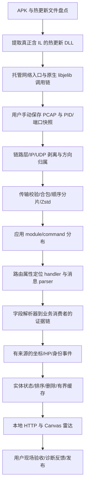

# 从零实现 UDP 雷达

从 APK 和热更新文件开始定位网络入口，再用实测 UDP 流量核对消息结构，最后把坐标、姓名和 HP 接入本地网页。已有成品的话，可以直接看部署步骤。[部署指南](REPRODUCE.md)

文中的文件哈希、偏移和消息号对应同一版本。复现时请自行准备有权分析的 APK、热更新文件和抓包样本。原始流量和坐标 CSV 保存在本地。

## 0. 实现流程



| 阶段 | 阶段结果 | 核对项 |
|---|---|---|
| 文件盘点 | 架构、版本、输入哈希、托管 DLL | 程序集能读取，方法有 IL |
| 网络定位 | 托管与原生收发调用链 | 当前会话使用的传输模式 |
| 流量归属 | 同期 PID、本地端口、PCAP、方向 | `ss` 是否把该端口关联到游戏 PID |
| 传输恢复 | 完整应用消息及来源记录 | 各类传输头的长度、合包及分片处理 |
| 字段研究 | 字段、目标成员、业务用途和数值换算 | 字段是否实际传入位置更新方法 |
| 离线核对 | 可追溯的原始值、缩放、包号和序号 | 解码和换算是否与回放记录一致 |
| 雷达工程 | 增量状态、网页、进程收尾和诊断 | 页面是否获取到初始化和名单 |
| 发布 | 原机运行文件、复现流程、工具和发布清单 | 记录实际验证过的设备和版本 |

`src/protocol.py` 把字节解析为事件，`identity.py` 解析身份消息，`server.py` 更新状态并提供只读 HTTP 接口，`runner.sh` 启停 Android 采集，`app.js` 负责网页显示。`dist/` 保存原机运行过的九个文件。

## 1. 工作目录和依赖

电脑可使用 Linux 或 WSL Ubuntu。除手机端步骤外，命令都从解压后的仓库根目录执行。`input/` 和 `work/` 放本地研究材料，发布时移到仓库外。Android 原生 shell 和 Operit Ubuntu 的用法见第 13 节。

建议先准备 Python >=3.9、libzstd、git、unzip、binutils、.NET 8 SDK；UnityPy/Capstone 仅研究时需要。Ubuntu 的 Python、libzstd、unzip、readelf/c++filt 可以由发行版包提供，.NET SDK 按对应系统安装说明准备。

```bash
python3 --version
python3 tools/check_environment.py
dotnet --list-sdks
readelf --version
c++filt --version
python3 -m pip install -r requirements-research.txt
```

安装依赖和 `dotnet restore` 可能需要联网，后续分析读取本地文件。打包环境缺少 .NET SDK，三个 `.csproj` 的标准构建须在装有 SDK 的电脑上验证。

下文使用这些相对路径存放研究材料。

```text
input/game.apk                 自行取得的固定版本安装包
input/update.bundle            自行取得的 UnityFS 热更新包
input/round.pcap                用户手动采集的真实经典 PCAP
input/sockets.txt               同期 PID/本地 UDP 端口快照
work/apk/                      APK 解包
work/hotupdate/                提取的 TextAsset/托管 DLL
work/index/、work/il/          类型索引/IL
work/native/                   原生函数反汇编
work/study/                    协议统计、选中应用消息、字段结构
```

公开包不含上表中的输入或分析输出。发布检查会拒绝 `input/`、`work/`、`build/`、`bin/`、`obj/` 和 `日志/`，完成研究后把这些目录移出仓库。

## 2. 从 APK 提取热更新程序集

### 2.1 确认 Unity 版本和程序集位置

```bash
unzip -l input/game.apk
unzip input/game.apk -d work/apk
```

解包后检查 `lib/arm64-v8a/`、`assets/bin/Data/`、`ScriptingAssemblies.json`、metadata 位置及 Unity 版本标记，再确认目标文件能否读出托管方法。

样本使用 Unity 2022.3.62f3。APK 同时含 ARM32 和 AArch64 文件，本文的原生地址都基于 AArch64 `libjelib.so`。项目早期做过 metadata 和 IL2CPP 恢复，后来从热更新程序集直接读到网络入口的 IL，可以先沿这条调用链往下查。

这版 APK 的热更新文件位于 `assets/android/data/code/`，文件名以 `updatescript` 开头。

```bash
find work/apk/assets/android/data/code -maxdepth 1 -type f -iname 'updatescript*'
```

按下表核对候选 bundle 的哈希，再把匹配文件的实际路径传给 `--bundle`。其他版本的热更新可能在另存的资源或缓存中。后续分析需要含方法体的程序集，只有 DummyDll 的话，仍需找到对应 bundle。

### 2.2 从 UnityFS TextAsset 提取程序集

```bash
python3 research/extract_hotupdate.py --bundle input/update.bundle --output work/hotupdate
```

工具读取各 `TextAsset` 的 `m_Script`，把带 MZ 文件头的候选项写入 `asset-manifest.json`。再用 Mono.Cecil 打开候选文件，确认能读到托管方法体。

复现样本的 SHA-256 如下。

| 输入 | SHA256 |
|---|---|
| UpdateScript_500.dll | 1ce1e36603c3c481a03a321edc1d08f6ba24f165855021b808effbb90d84a5ec |
| libjelib.so | a6e64e050d3ac896bb5310e3bcfc80f8d724188b6db1955e216bb868641526f6 |
| 热更新 bundle | 63a76b500939a3b3e99233975abee294e31586cd6c33aaabd090193d3239eb11 |

每次先核对并记录哈希。恢复脚本会校验输入，提取和反汇编工具记录哈希后仍需手动与表中值核对。

### 2.3 可选的 metadata 和 IL2CPP 恢复

需要补查静态类型和原生地址时，再做这一步。

```bash
python3 research/restore_inputs.py metadata --input work/apk/assets/bin/Data/Managed/Metadata/global-metadata.dat --output work/metadata-restored
python3 research/restore_inputs.py il2cpp --input work/apk/lib/arm64-v8a/libil2cpp.so --metadata-report work/metadata-restored/restore-report.json --output work/il2cpp-restored
```

metadata 恢复源码展示固定文件的稀疏 XOR 区间、0x66 与表边界/stride/token 检查。IL2CPP 分支针对固定 .rodata 的 XOR/块重排，依赖 metadata 报告的 images 校验；初始 AES 窗口和代码区没有全恢复。输出是分析副本，不能替换安装库。

早期导出了 `dump.cs`、方法地址索引和 DummyDll，header、stringliteral 等附属输出仍不完整。下文的网络分析依据热更新 DLL 的 IL 和 `libjelib.so` 的符号及汇编。

## 3. 从混淆程序集定位网络入口

### 3.1 建索引并追踪收发调用

```bash
dotnet build research/managed/StaticAssemblyInspect -c Release
dotnet build research/managed/ProtocolEvidenceInspect -c Release
dotnet build research/managed/StaticReferenceInspect -c Release
dotnet run --project research/managed/StaticAssemblyInspect -c Release -- index work/hotupdate/UpdateScript_500.dll work/index
```

得到 candidate-index.json、type-index.tsv、network-crypto-calls.json。索引按 udp/socket/send/receive/crypto 等词和外部 API 调用收敛候选；混淆名称不能靠关键词覆盖全部方法，下一步要追调用与字段引用。

在索引中搜索已知的网络关键词和类型名。

```bash
grep -Ein 'udp|socket|libUdp|ExternDll|DHPODGOMOID|NLJGAHGAAEH' work/index/type-index.tsv work/index/candidate-index.json
```

在这份样本中，`DHPODGOMOID` 选择传输模式。`NLJGAHGAAEH` 经 `ExternDllManager` 调用 `libUdpConnect`、`libUdpSend` 和 `libUdpRecv`，原生实现位于 `libjelib.so`。代码同时定义了 TCP 和 KCP 模式，当前会话实际走哪个分支要结合调用链和抓包确认。

```bash
dotnet run --project research/managed/StaticAssemblyInspect -c Release -- types work/hotupdate/UpdateScript_500.dll work/net-types DHPODGOMOID NLJGAHGAAEH ExternDllManager
dotnet run --project research/managed/StaticAssemblyInspect -c Release -- il work/hotupdate/UpdateScript_500.dll work/net-il 0x06012A84 0x0601F599
```

查看模式分支实例化的对象、P/Invoke 入口，以及接收后读取应用头和查找 handler 的位置。从 `types` 输出取方法 token，再用 `il` 看方法体。`StaticReferenceInspect` 可以按 token 查调用方。

```bash
dotnet run --project research/managed/StaticReferenceInspect -c Release -- work/hotupdate/UpdateScript_500.dll work/recv-callers 0x0601F599
```

打开 `references.json` 核对 `hits` 和对应的 IL。同一消息类可能同时有构造函数、写入器、解析器和业务方法，从签名和实际读写指令可以分清各自的角色。

## 4. 手动采集 PCAP 和端口记录

在自己的设备和测试账号上手动采集，PCAP 与同期端口记录留在本地。

### 4.1 在 Android 原生 Root shell 确认端口

```sh
pidof com.pi.czrxdfirst
ss -H -u -a -n -p -e
```

同时保存 PID 和 socket 表，用 `ss` 把本地端口关联到游戏 PID。端口可能在进场时变化，进场前后都要留一份快照。

### 4.2 采集一段测试会话

在原生 shell 中把 PCAP、端口表和 `TMPDIR` 放在同一私人会话目录。以下使用项目目录下的 `日志/manual-session/`。

```sh
SESSION='/storage/emulated/0/Download/超自然行动/日志/manual-session'
mkdir -p "$SESSION/tmp"
export TMPDIR="$SESSION/tmp"
pidof com.pi.czrxdfirst > "$SESSION/game-pids.txt"
ss -H -u -a -n -p -e > "$SESSION/sockets-before.txt"
/system/bin/tcpdump -p -i any -nn -s 0 -U -B 4096 -w "$SESSION/round.pcap" udp
```

`tcpdump` 在前台运行。进入测试场景完成操作后按 Ctrl+C，确认进程退出，再离线读取文件。PCAP 记录全机 UDP，可能包含其他应用的流量，原始文件只保存在本地。进场后再手动保存一份 `ss` 端口表。成品 `runner.sh` 会轮询端口，供持续采集时使用。

通过 USB 或 MTP 把 PCAP 和端口记录复制到 `input/`。解码时只传入游戏 PID 对应的本地端口，归属不清时先补端口快照。

### 4.3 从进场前开始采集

坐标会持续下发，名单和本地 UID 可能只在初始化时出现。半路开始抓包，网页可能有坐标却缺姓名。若收到名单却没有坐标，可回查 PCAP 和端口表，确认是否漏掉了主业务流。

## 5. 从 PCAP 读取 UDP

经典 PCAP 的全局头为 24 字节。每条记录由 16 字节记录头和 `caplen` 字节的帧组成。用 magic 判断字节序和微秒或纳秒时间单位，检查 `caplen <= original` 及长度上限。实时读取遇到只写了一半的记录时，回到记录起点等下一轮。

Android 用 `-i any` 采集时常见 Linux cooked link。类型 113 的头长为 16，276 为 20，也可能遇到 Ethernet (1)、RAW (101)、IPv4 (228) 或 IPv6 (229)。`PcapTail.poll` 和 `udp` 按链路类型查找 IP 起点。

IPv4 用 IHL 算头长、total length 限边界、protocol=17 才进入 UDP；本实现不重组 IP 分片。IPv6 当前只覆盖直接 UDP，不完整遍历扩展头。UDP 用大端 UInt16 读 sport/dport/length，取载荷时再检查长度。

`dport` 在已确认的本地端口集合里且 `sport` 不在时，该包是入站候选。`sport` 在集合里则按出站处理。Linux cooked 的 `packet_type=4` 也提示出站。两端同时命中时，方向仍有歧义。

用 PCAP 工具核对记录总数和时间区间，再按方向统计已确认端口。损坏记录、分片和非 UDP 分别计数。公开记录保留统计，端点地址留在本地。

## 6. UDP 传输头和应用载荷

### 6.1 查看原生收发代码

```bash
python3 research/disassemble_native.py --so work/apk/lib/arm64-v8a/libjelib.so --output work/native
```

脚本读取 ELF64 little-endian AArch64 PT_LOAD，用 VA 映射文件偏移，readelf 取 dynsym、c++filt 解名、Capstone 反汇编。不要将符号 VA 直接当文件偏移。按 manifest 找 JeUdpClient::RecvLoop、udpParse、msgParse、AsyncSend、GetMsg、JeMsgQueue::PushMsg。

从 `recvfrom` 往下看头字段的读取、重组和解压分支，以及入队的位置。再从发送链核对这些字段的写入方式。

flag 分支通过 PLT 调用 `Zstd::Decompress`，说明这一路处理的是压缩。当前证据只覆盖这一调用链，cookie、序号和时钟的用途还要分别核对。

### 6.2 下行头的字段和校验

| 相对该传输片的字节 | 用法 | 证据和实现 |
|---|---|---|
| 0 | 校验字节 | AsyncSend 固定 VA 0x5ab78..0x5abbc |
| 1 | flag/kind | 低4位数据 kind 4/5；其余分支见下文 |
| 2..3 | 小端 UInt16 序号 | 连续片/合包链校验需考虑回绕 |
| 其后头区 | 公共部分 | 部分字节含义尚未确认 |
| 普通/首片应用起点 | 10 | 公共头8字节后还有2字节 |
| 后续片有效载荷起点 | 8 | 先去后续片头再拼接 |

校验：

```python
valid = data[0] == ((len(data) + data[1] + data[2] + data[3]) & 0xff)
seq = int.from_bytes(data[2:4], 'little')
```

`len(data)` 取单片的完整字节数。校验分别加上序号的低、高字节。早期测试把序号当作一个整数相加，高字节非零时就失败了，回看 `AsyncSend` 汇编确认了公式。

`0x20` 表示后续分片，`0x40` 表示后面还有分片，`0x80` 是压缩位。当前 `feed_many` 跳过非数据 kind，以及 kind 4 带控制位的分支。

### 6.3 上下行头的区别

成品下行解析使用首片偏移 10、后续片偏移 8、序号偏移 2。早期样本中，上行应用数据从偏移 14 开始，序号在字节 6～7。历史分析脚本和实测 3/851 分布都支持这一点。`survey` 按方向使用对应的偏移，带分片标志的上行记录会跳过并计数。

上行也按长度和字节 1～3 校验字节 0，序号位置的变化不影响这个公式。如果还能读出 `UInt16`，但 `module` 大量分散，先核对应用数据的起点。

### 6.4 拆分同一 UDP 记录中的多个消息

`transport_segments` 先检查整条是否满足单片校验；不满足时，对候选切点做完整头、校验和连续序号链约束。长度校验只给长度模256，候选长度要加256继续尝试；只有全载荷唯一完整解才拆。实现有搜索预算/段数上限，避免对脏数据无界递归。

### 6.5 下行重组和 Zstd 解压

每个流的键包含源/目的地址端口及 kind。首片保留初始 flag 与 body[10:]；后续片只追加 body[8:]，序号必须等于 next。末片到达再产出完整 app，若初始 flag 有压缩位则解压。每消息8 MiB、512片、15秒和16条流等上限见代码；缺片/乱序/过期直接记账，不伪造恢复。

重组和解压完成后，应用头才从偏移 0 开始。IP 分片发生在 UDP 之前，游戏传输分片和同记录合包分别按本节和上一节处理。

## 7. 统计实际出现的应用消息

应用头是两个大端 UInt16：

```python
module, command = struct.unpack_from('!HH', app)
body = app[4:]
```

`survey` 从本地 PCAP 统计两个方向的消息号，暂时只读应用头。

```bash
python3 research/pcap_lab.py survey input/round.pcap --ports 45283 --direction both --summary work/study/survey.json
```

命令里的 `45283` 是历史样本的业务端口，运行时换成自己确认过的端口。辅助端口可能使用不同的传输头，需单独核对。该工具沿用第 6 节的解析规则来统计 `module/command`。

在 `commands` 中查看 `direction`、`module`、`command` 和 `applications`。`applications` 统计的是应用消息。退出码 3 表示只处理了一部分或没有匹配项，可以继续看 `decode_errors`、分片计数和 `pending`。

### 3/50 与实测的 3/851、3/852

初期从静态网络入口找到 3/50 BatchMove，并追到 MNEHOHLMOCB→PMEEGHODBLL→DHFLOFIEDAF。位置向量标签虽为 wire5，实际却用 varint→ZigZag→除100。这是一条有静态证据的独立结构。

第一份真实会话里，主业务流主要出现下行 3/852 和上行 3/851。坐标分析由此转向 852 的 handler、场景实体和动作数组，沿对应的解析器核对编码。

早期的 `research/legacy_move50.py` 读取已恢复的应用消息或单独的 body。

```bash
python3 research/legacy_move50.py --workspace . --kind app --input work/study/move50.app --output work/study/move50-decoded.json
```

拿到 3/50 应用消息后才需要执行这一步。首份会话没有观测到该消息，现有验证记录只覆盖 3/50 的静态分析。

## 8. 3/852 的路由和消息结构

扫描方法属性，找到注册处理 3/852 的 handler。

```bash
dotnet run --project research/managed/ProtocolEvidenceInspect -c Release -- routes work/hotupdate/UpdateScript_500.dll work/routes.json 1 3 6 50 851 852 2005
```

路由属性 `HNMOBHFEEON` 先收 `command`，再收 `module`。用 852 handler 和其他已知路由交叉确认。3/852 的 handler 是 `FMPDBDEEKGC::MMMFDMBPCAO`，token 为 `0x06016A77`，参数类型为 `BILKNBOMFCO`。

```bash
dotnet run --project research/managed/StaticAssemblyInspect -c Release -- types work/hotupdate/UpdateScript_500.dll work/scene-types BILKNBOMFCO EMEOJKBBAAA FOOBJALACEJ
dotnet run --project research/managed/StaticAssemblyInspect -c Release -- il work/hotupdate/UpdateScript_500.dll work/scene-il 0x06016A77 0x06026483 0x06004FBC 0x06012856
```

从 handler 找到遍历场景实体的位置，再查看解析器怎样读取 tag 和写入成员。记录字段号、wire type、值类型、目标成员和 packed 或重复字段的处理方式。

| 层级 | field | 读取/对应输出 |
|---|---|---|
| 场景 BILKNBOMFCO | 4、5 | varint，帧相关值，保留 frame4/frame5 |
| 场景 | 6 | 重复嵌套 EMEOJKBBAAA 实体 |
| 场景 | 7 | 删除编号，接受 unpacked或packed |
| 实体 EMEOJKBBAAA | 1 | 运行时 id1 |
| 实体 | 2 | 次编号 id2，保留，不能当账号UID |
| 实体 | 3 | 类别 |
| 实体 | 4 | 重复嵌套 FOOBJALACEJ 动作 |
| 动作 FOOBJALACEJ | 1 | 动作 kind |
| 动作 | 2 | scale |
| 动作 | 3 | Int64 值列表，packed/unpacked |
| 动作 | 4 | 载荷保留字段，本雷达不使用其业务语义 |

### 8.1 逐层核对样本字段

```bash
python3 research/pcap_lab.py extract input/round.pcap --ports 45283 --direction in --message 3/852 --output work/study/scene.app
python3 research/pcap_lab.py fields work/study/scene.app --output work/study/scene-fields.json
python3 research/pcap_lab.py fields work/study/scene.app --path 6:1 --output work/study/entity-fields.json
python3 research/pcap_lab.py fields work/study/scene.app --path 6:1/4:1 --output work/study/action-fields.json
```

`fields` 默认从绝对偏移 4 开始。`6:1/4:1` 指第一个 field 6 子消息里的第一个 field 4，计数从 1 开始。如果该帧没有实体或动作，改选有数据的字段，或在 `extract` 中用 `--occurrence N` 另取一帧。

`fields` 只列绝对偏移、长度、无符号 varint 和少量十六进制字节，子消息由 `--path` 指定。确认 wire 1 或 5 采用标准定长编码后才加 `--standard-fixed`，3/50 的自定义 wire 5 有单独的读法。

这一步核对字段边界。动作 kind 1 的用途还要看它的调用方。

## 9. 确认坐标字段和换算方式

### 9.1 从动作找到位置更新

枚举里的 `Position=1` 提供了起点。沿动作分派跟下去，可以看到 `0x06002E55` 将三个值交给 `0x06021E2E` 换算为 `Vector3`，再送入位置更新方法。`0x06021E29` 也有类似的向量写入逻辑。

```bash
dotnet run --project research/managed/StaticAssemblyInspect -c Release -- il work/hotupdate/UpdateScript_500.dll work/position-il 0x06002E55 0x06021E2E 0x06021E29
dotnet run --project research/managed/StaticReferenceInspect -c Release -- work/hotupdate/UpdateScript_500.dll work/position-callers 0x06021E2E
```

在 IL 里核对三个分量的读取顺序、浮点转换、除法使用的 `scale`，再从引用中找到位置写入。[证据索引](EVIDENCE_WALKTHROUGH.md)

### 9.2 两种坐标编码

| 分支 | 实际整数方式 | 坐标计算 | 验证状态 |
|---|---|---|---|
| 3/50中DHFLOFIEDAF向量 | 自定义wire5 varint、ZigZag | signed/100 | 早期静态链；该真实主会话未观测 |
| 3/852动作1 | Int64补码varint，packed/unpacked | raw/action.scale；样本常见1000 | 主会话真实解码与CSV核对 |

3/852 用下面的方式还原有符号整数并换算坐标。

```python
signed = unsigned - (1 << 64) if unsigned >= (1 << 63) else unsigned
xyz = [raw / scale if scale > 0 else float(raw) for raw in values]
```

只有 kind 1 且恰好有三个值时才生成位置。`scale <= 0` 时把原值转为浮点后保留。坐标换算后的物理单位尚未确认。

### 9.3 用 PCAP 和 CSV 核对

保留 `packet`、`timestamp`、`local_port`、`stream`、`sequence`、`frame4/5`、`category`、`id1/id2`、`raw_x/y/z`、`scale` 和 `x/y/z`，便于从网页上的点追到原始记录。

```bash
python3 tools/replay_pcap.py input/round.pcap --ports 45063,45283 --summary work/study/replay-summary.json --events work/study/events.jsonl
```

有基线 CSV 时可加 `--expected-csv`。历史样本含 8184 包，解出的 7101 条位置与 CSV 逐条匹配。若 CSV 出自同一解析器，这只能验证解码和回读一致。游戏内的表现需观察移动、停止、高度变化和切换场景。后续用户确认原机可用，其他版本尚未验证。

上行 3/851 的完整结构仍待确认。本地身份依据下一节的协议字段识别。

## 10. 姓名、UID、本地身份和 HP

### 10.1 从姓名 UI 追到名单解析器

`CzrPlayerNameUI::SetInitData` 接收字符串、`UInt64` 和 `UInt32`。先找传入这些值的调用方，再从角色构造和 getter 追到 `MNKGAOHNBGO` 的字段，最后看这些字段如何从字节解析出来。

```bash
dotnet run --project research/managed/StaticAssemblyInspect -c Release -- il work/hotupdate/UpdateScript_500.dll work/name-il 0x0600EE78 0x060038F2 0x06003CEB 0x0602392C 0x0601CD83
dotnet run --project research/managed/StaticReferenceInspect -c Release -- work/hotupdate/UpdateScript_500.dll work/name-callers 0x0600EE78
dotnet run --project research/managed/StaticAssemblyInspect -c Release -- il work/hotupdate/UpdateScript_500.dll work/identity-link-il 0x0600654A 0x0600651A
```

`MNKGAOHNBGO` 的解析器 `0x0601CD83` 读取 field 1（`UInt32` 运行时实体号）、field 2（`UInt64` UID）和 field 3（UTF-8 姓名）。两处查字典的代码都把类别 4 实体的 `id1` 与名单的运行时实体号关联起来。

### 10.2 登录、名单和本地身份

| 消息 | 固定已解析内容 | 状态动作 |
|---|---|---|
| 3/1 登录/初始化 | field2本地UID、field3本地实体号、field5名单容器 | 清旧流身份/实体并建立本地状态 |
| 3/3 名单 | field1玩家列表 | 更新名单 |
| 3/6 名单增删 | field1玩家列表、field2删除ID packed/unpacked | 增量更新并删对应实体/HP |
| 3/2005 当前观察目标 | field 1，本地观察 UID | 记录当前观察目标，登录 UID 单独保留 |

导出0x060110F7、0x0601B524、0x0601BF43及路由handler IL进行复核。`identity.py`是这些边界的代码实现；UID输出字符串，避免浏览器Number损失UInt64精度。

后端只给类别 4 实体按流和 `id1` 关联名单。优先比较非零 UID 和本地 UID，有本地实体号时也可在对应命名空间匹配。数据不足就保持未识别。手动选择参考点只改变画面中心。

### 10.3 动作 31 的 HP 原值

```bash
dotnet run --project research/managed/StaticAssemblyInspect -c Release -- il work/hotupdate/UpdateScript_500.dll work/hp-il 0x060038F8 0x06003ACA 0x06002DAA
```

玩家动作 31 由 `0x06003ACA` 处理。它将 `values[0]` 经过 `conv.i4` 后写入生命字段，NPC 的处理函数同样读取首值。雷达用以下方式将它转成 `Int32` 原值。

```python
hp = ((values[0] + (1 << 31)) % (1 << 32)) - (1 << 31)
```

页面直接显示该原值，最大血量和百分比仍未确认。HP 与位置可能先后到达，后端单独缓存 HP 和时间戳。实体首次收到位置时可以补上已缓存的 HP，缺失时显示“未收到”。

## 11. 协议解析器和事件接口

先实现独立的字节解析层，再接入实时采集。

1. 给 `Reader` 加入变长整数、长度字段、wire 类型与字段数的边界检查。
2. scene/entity/action结构，分清packed与unpacked，保留原整数。
3. identity结构，严格UTF-8，不按文本猜名字。
4. PCAP/IP/UDP、传输拆包/重组/解压。
5. feed_many：一条记录返回零到多条应用事件，错误分别计数。

每条 PCAP 记录经 `feed_many` 产生零到多个事件。

```python
for timestamp, packet, link, frame in reader.poll():
    for event in decoder.feed_many(timestamp, packet, link, frame):
        state.apply(event)
```

`scene` 事件带 `positions`、`health_updates`、`removed` 和帧号。`identity` 事件带 `players`、`removed`、`reset` 以及可选的 `local_uid` 和 `local_entity_id`。实时读取和端口识别后的补解析都遍历 `feed_many` 的返回值。旧 `feed` 只返回第一个事件，用它会漏掉同包后面的消息。

未知字段或长度不合法时保留相应的错误计数，解码时继续执行校验和长度检查。

## 12. 实体状态和更新顺序

`server.py` 为每个实体保留最新状态和一小段轨迹。

### 12.1 流、实体和会话重置

以 `local_port@peer` 区分流，再加 `category/id1/id2` 组成实体键。不同会话可能复用同一个运行时 ID，需要在会话重置时清理状态。

`apply` 按 `stream/kind/event_type` 检查序号。用 `(new-old)&65535` 处理 16 位回绕，结果大于 32767 就当作旧序号。`identity` 和 `scene` 分别判断顺序，防止场景帧的高序号挡掉名单更新。

游戏进程换代时清理实体、身份、HP、顺序、去重记录和传输分片，并按新进程的开始时间过滤旧缓存。收到 3/1 时，即使 PID 相同也处理 `reset`。

### 12.2 更新与删除

位置到达更新最新xyz，轨迹只在位置变化时追加，deque最多60点。HP到达独立缓存，再合并已有实体。身份到达按流更新名单，并重新给存量category4实体附名；这样“先位置后姓名”也能补齐。

3/852 的 field 7 删除实体和 HP，3/6 删除名单条目和对应的类别 4 实体。后端条目 300 秒过期，实体和 HP 缓存上限各为 512，名单上限 2048。网页会提前把停更的点变灰或隐藏。

### 12.3 增量读与有界日志

每约0.12秒尾读PCAP，未写完记录等下一轮，不从文件头反复全量扫描。线程更新快照加锁；HTTP读稳定副本，避免绘图读到一半更新的数据。

位置日志约 16 MiB 后停止追加，元数据日志的上限约 8 MiB。诊断文件约每 2 秒写到临时路径，再原子替换。日志可能含玩家信息，只保存在本地。

## 13. Android 持续采集和端口识别

旧版发现端口后才启动 `tcpdump`，PID 或端口变化时还会重启采集，中间会漏掉数秒流量。进场名单如果出现在这段时间里，后端就无从补回。

从 v2.1 起，手动启动 `runner.sh` 时先运行 `tcpdump`，再启动 proot 后端。后端每秒通过 `ss` 更新端口归属，采集进程持续运行。全机 UDP 先进入缓存，端口关联到游戏 PID 后再补解析该端口的记录。缓存最多保留 15 秒、8 MiB 或 8192 条，超限会丢弃并计数。

启动和停止按以下顺序处理。

1. 启动脚本验证时间/HTTP端口与项目路径，创建会话tmp和日志。
2. runner先记录一个持续PCAP，保留捕获进程PID与退出原因。
3. proot映射共享存储，Ubuntu Python运行server.py，只绑回环HTTP。
4. 等待 `server-ready`。启动失败或 `tcpdump` 退出时，清理本次会话。
5. 循环维护PID/端口/时间与目录体积；默认600秒或约64MiB触发停止。
6. 停止脚本只终止本次会话记录的 PID。关掉网页后，采集还会继续，需执行停止脚本。

把采集限制在测试会话内，原始 PCAP 留在本地。电脑端的 `--stage` 只在电脑上准备文件，传输到手机后再按部署指南执行对应环境的步骤。[部署指南](REPRODUCE.md)

## 14. 网页接口和雷达绘制

### 14.1 本地 HTTP 和状态快照

`server.py` 监听 `127.0.0.1`，只提供 `/api/state` 和固定静态文件。`Host` 限于本机地址及端口，响应设置 `no-store`、`nosniff` 和 CSP。前端用 `textContent` 显示协议姓名。

快照包含时间戳、身份接收状态、HP 接收时间、端口和错误计数，页面可据此解释为何部分点没有姓名或 HP。

### 14.2 将世界坐标投影到 Canvas

默认绘制 X/Z 平面，以参考实体或本地实体为中心。`span` 是可见世界宽度，`W` 和 `H` 是画布宽高。

```text
pixels_per_unit = W / span
screen_x = W/2 + (world_x - center_x) * pixels_per_unit
screen_y = H/2 + sign * (world_z - center_z) * pixels_per_unit
```

`sign` 默认为 `-1`，翻转选项切换上下方向。画面支持自动调整范围，以及手动平移和缩放。和游戏小地图的配准与朝向仍未验证。

轨迹使用同一投影，颜色按实体键分配。只有确认身份的本地实体才显示为“自己”。停更 3 秒后变灰，30 秒后隐藏。表格显示 XYZ、相对高度、水平距离和上次更新时间，用来排查坐标轴、缩放和停更问题。

### 14.3 拉取、暂停和跟随

前端约每 400 毫秒轮询一次，2.5 秒超时，失败时显示后端未连接。暂停时页面会提示采集仍在继续。自动跟随最近一个明确标为 `is_local` 的实体，手动选参考点时取消自动跟随。

## 15. 姓名缺失与常见故障

### 15.1 部分姓名显示、部分不显示

先区分名单未收到与收到但decode失败。历史样本定位到第115条PCAP记录：一条156字节UDP载荷里有序号15/16的两个3/6名单。旧版整个body当一条Protobuf，尾部传输头被当字段，出现zero identity field，名字整条丢掉。

修复时先用 `AsyncSend` 确认头校验，再按唯一连续链拆包，最后让后端接收 `feed_many` 返回的全部事件。样本中的第 97、98 条记录也是一组完整的顺序分片。支持重组后，样本中解出的坐标由 4363 条增加到 4429 条。

这份样本最后解出 4 条身份消息、4 个名单条目和 7 条 HP 动作，应用解析错误为 0，另有 4 个未支持的 IP 分片。用户随后在原机确认显示正常。

### 15.2 诊断决策表

| 现象 | 先查 | 下一步证据 |
|---|---|---|
| 无端口 | capture.json、ss/PID | 系统权限、快照时刻、正确本地端口 |
| 有端口无应用 | 校验/压缩/方向/非UDP计数 | native收发链、真实头部、link类型 |
| 有3/852但无位置 | action_counts、scale/raw | 枚举只是线索，回到parser和位置消费者 |
| 有坐标无姓名 | identity_messages、roster_players、decode_errors | 进场前采集是否覆盖、合包/分片、身份路由 |
| 有名单但名字没附点 | category、id1、stream、重置/顺序 | 两个字典消费者的同命名空间证据 |
| HP永远缺失 | hp_actions是否有31 | 没收到与解析错误分开，不能凭UI猜最大值 |
| 数据突然回旧 | 序号、PID epoch、参考点年龄 | 乱序/重置/旧缓存过滤 |
| 退出码0但信息少 | 包数、目标事件、未处理指标 | “没报错”不是“收到全部” |

## 16. 验证与发布

记录静态证据、PCAP 回放结果、后端和文件检查，以及实际游戏内表现。为各项结果注明输入哈希、版本和验证范围。

公开包包含复现文档、源码、原机成品、辅助工具和输入哈希。PCAP、玩家字段、端点、坐标明细、游戏 DLL/SO/APK、密钥和设备私人路径留在本地。

```bash
python3 tools/build_dist.py --check
python3 tools/publish_check.py .
```

这两条命令检查本地文件。打包时使用 UTF-8 ZIP，并核对 `FILES_SHA256.json` 和 `SOURCE_ORIGIN.json`。文档和辅助工具修改后更新清单。运行文件改动后应另记候选版本及验证状态。

发布前核对许可证、署名和目标仓库，并检查 Git 跟踪文件和历史中的私人数据。三个 SDK 工具的构建结果按实际运行环境记录，项目当前没有 GitHub CI。[发布清单](PUBLISH_CHECKLIST.md)
